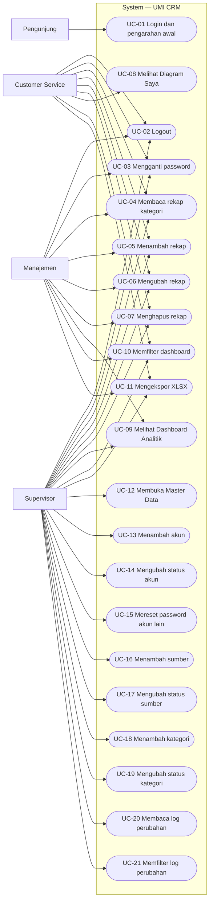

# 03 — Use Case

## Diagram global

Garis menghubungkan aktor dengan kapabilitas, bukan urutan eksekusi. `Sistem` merupakan batas aplikasi. CS berarti Customer Service. Ekspor CS tersedia melalui endpoint langsung, bukan tombol UI.

## Daftar dan traceability

| ID | Name | Actor | Related FR |
|---|---|---|---|
| UC-01 | Login dan pengarahan awal | Pengunjung | FR-01, FR-03, FR-05 |
| UC-02 | Logout | Semua pengguna | FR-02 |
| UC-03 | Mengganti password | Semua pengguna | FR-04, FR-05 |
| UC-04 | Membaca rekap kategori | Semua pengguna | FR-06 |
| UC-05 | Menambah rekap | Semua pengguna | FR-07, FR-10, FR-11, FR-26 |
| UC-06 | Mengubah rekap | Semua pengguna sesuai izin | FR-08, FR-10, FR-11, FR-26 |
| UC-07 | Menghapus rekap | Semua pengguna sesuai izin | FR-09, FR-26 |
| UC-08 | Melihat Diagram Saya | Customer Service | FR-12 |
| UC-09 | Melihat Dashboard Analitik | Manajemen, Supervisor | FR-13 |
| UC-10 | Memfilter dashboard | Semua pengguna | FR-14 |
| UC-11 | Mengekspor XLSX | Non-CS; CS melalui endpoint | FR-15 |
| UC-12 | Membuka Master Data | Supervisor | FR-16 |
| UC-13 | Menambah akun | Supervisor | FR-17, FR-26 |
| UC-14 | Mengubah status akun | Supervisor | FR-18, FR-26 |
| UC-15 | Mereset password akun lain | Supervisor | FR-19, FR-26 |
| UC-16 | Menambah sumber | Supervisor | FR-20, FR-26 |
| UC-17 | Mengubah status sumber | Supervisor | FR-21, FR-26 |
| UC-18 | Menambah kategori | Supervisor | FR-22, FR-26 |
| UC-19 | Mengubah status kategori | Supervisor | FR-23, FR-26 |
| UC-20 | Membaca log perubahan | Supervisor | FR-24 |
| UC-21 | Memfilter log perubahan | Supervisor | FR-25 |

## Konvensi skenario

Kecuali UC-01, prasyarat umum adalah pengguna telah login dan akunnya aktif. Semua fungsi operasional selain password/logout juga memerlukan `must_change_password = false`. Kegagalan autentikasi mengarah ke login; akun yang dinonaktifkan dikeluarkan oleh middleware. Validasi HTML umumnya mengembalikan pengguna beserta error dan input sebelumnya; dashboard memiliki fallback khusus. Penolakan akses 403 dan record/binding tidak ditemukan 404 tidak boleh ditafsirkan sebagai validasi form biasa.

### UC-01 — Login dan pengarahan awal

- **Aktor:** Pengunjung. **Deskripsi:** Memulai session sesuai role akun.
- **Prasyarat:** Belum login; akun tersedia.
- **Alur utama:**
  1. Aktor membuka `/login`.
  2. Aktor mengisi `Email`, `Password`, dan `Pilih Peran`, kemudian memilih `Login`.
  3. `AuthController@store` memvalidasi input, password, status aktif, dan kecocokan role.
  4. Sistem login dan meregenerasi session ID.
  5. Sistem menggunakan intended destination atau `home`; CS diarahkan ke kategori aktif pertama dan non-CS ke dashboard.
- **Alternatif/exception:** Password/role salah atau akun nonaktif menghasilkan error; pembatasan request dapat menghasilkan 429. Bila wajib mengganti password, sistem mengarah ke UC-03. Bila tidak ada kategori aktif, home CS menghasilkan 404 dengan pesan `Belum ada kategori layanan yang aktif.`.
- **Postcondition:** Session login aktif atau tetap guest jika gagal.
- **Sumber:** `AuthController`, `HomeController`, `routes/web.php`.

### UC-02 — Logout

- **Aktor:** Semua pengguna. **Deskripsi:** Mengakhiri session perangkat saat ini.
- **Prasyarat:** Prasyarat umum; dapat dijalankan walaupun wajib mengganti password.
- **Alur utama:**
  1. Aktor memilih `Logout`.
  2. Form mengirim POST ke `logout`.
  3. Sistem menjalankan logout, invalidate session, dan regenerate token.
  4. Sistem mengarah ke login.
- **Alternatif/exception:** Guest tidak memperoleh akses aksi terlindungi; request forgery yang gagal ditolak middleware.
- **Postcondition:** Session saat ini tidak terautentikasi; tidak ada klaim logout seluruh perangkat.
- **Sumber:** `AuthController@destroy`, `layouts/app.blade.php`.

### UC-03 — Mengganti password

- **Aktor:** Semua pengguna. **Deskripsi:** Mengganti password biasa atau sementara.
- **Prasyarat:** Prasyarat umum; tidak mensyaratkan password sudah diganti.
- **Alur utama:**
  1. Aktor membuka `Ubah Password` atau diarahkan ke `Ganti Password` wajib.
  2. Aktor mengisi password saat ini, password baru, dan konfirmasi.
  3. Sistem memvalidasi password lama, panjang minimal delapan, konfirmasi, dan perbedaan password.
  4. Sistem menyimpan hash, menghapus flag wajib ganti, dan meregenerasi session.
  5. Sistem mengarah ke home.
- **Alternatif/exception:** Password lama salah, konfirmasi berbeda, password baru pendek atau sama ditolak; hash/flag tidak diubah oleh validasi gagal.
- **Postcondition:** Password baru berlaku dan akses operasional dibuka. Tidak ada audit perubahan password sendiri atau revokasi seluruh session secara eksplisit.
- **Sumber:** `PasswordController@edit/update`.

### UC-04 — Membaca rekap kategori

- **Aktor:** Semua pengguna. **Deskripsi:** Meninjau rekap dan total kategori seluruh staf.
- **Prasyarat:** Umum operasional; kategori aktif.
- **Alur utama:**
  1. Aktor membuka `Input Data Leads` dan memilih kategori.
  2. Sistem mengambil rekap kategori beserta pemilik/sumber.
  3. Sistem menampilkan 50 baris per halaman, terbaru dahulu.
  4. Aktor berpindah halaman bila tersedia; total tetap mencakup seluruh kategori.
- **Alternatif/exception:** Kategori nonaktif/tidak ada menghasilkan 404; tanpa data muncul empty state. CS melihat baris staf lain sebagai hanya baca.
- **Postcondition:** Tidak ada perubahan data.
- **Sumber:** `LeadController@index`, `leads/index.blade.php`.

### UC-05 — Menambah rekap

- **Aktor:** Semua pengguna. **Deskripsi:** Mencatat jumlah prospek harian.
- **Prasyarat:** Umum operasional; kategori aktif; sumber aktif; pemilik CS valid.
- **Alur utama:**
  1. Aktor memilih tanggal, sumber, lima jumlah; non-CS juga memilih `Nama Admin`.
  2. Aktor memilih `Simpan Data`.
  3. Policy dan validasi dijalankan; CS ditetapkan sebagai pemilik sendiri.
  4. Sistem memeriksa kombinasi duplikat dan jumlah di atas 10.
  5. Sistem menyimpan lead dan audit dalam satu transaksi.
  6. Sistem mengarah ke daftar dengan `Data disimpan.`.
- **Alternatif/exception:** Tanggal masa depan/lebih tua 30 hari, sumber tidak valid, jumlah negatif/noninteger/>9999 ditolak. Duplikat tidak disimpan dan menawarkan edit bila berizin. Angka >10 menunggu `Ya, simpan`; `Periksa lagi` tidak menyimpan. Benturan unique constraint menghasilkan error untuk memuat ulang/edit.
- **Postcondition:** Satu rekap aktif dan audit baru tersedia, atau tidak ada perubahan bila ditolak/dibatalkan.
- **Sumber:** `LeadController@store/save`, `LeadPolicy@create`, migration lead.

### UC-06 — Mengubah rekap

- **Aktor:** Semua pengguna sesuai policy. **Deskripsi:** Memperbaiki rekap yang sudah ada.
- **Prasyarat:** Umum operasional; CS pemilik dan entri belum terkunci, atau non-CS aktif.
- **Alur utama:**
  1. Aktor memilih `Edit`; GET `leads.index?edit=ID` mengisi form.
  2. Aktor memperbaiki input dan memilih `Perbarui Data`.
  3. Sistem memeriksa policy, binding kategori, validasi, duplikat, dan konfirmasi angka tinggi.
  4. Sistem memperbarui lead dan mencatat audit dalam transaksi.
  5. Sistem menampilkan `Perubahan disimpan.`.
- **Alternatif/exception:** CS pada baris orang lain atau lebih tua 30 hari mendapat penolakan. Binding kategori/lead tidak cocok menghasilkan 404. `Batal` kembali ke daftar. Non-CS boleh mempertahankan/mengubah tanggal lama tetapi tidak tanggal masa depan. Sumber/pemilik nonaktif yang sudah dimiliki entri tetap dapat dipertahankan.
- **Postcondition:** Rekap berubah dengan audit; snapshot lama hanya lima jumlah, bukan seluruh metadata.
- **Sumber:** `LeadController@index/update/save`, `Lead::isEditableBy`.

### UC-07 — Menghapus rekap

- **Aktor:** Semua pengguna sesuai policy. **Deskripsi:** Menyembunyikan rekap melalui soft delete.
- **Prasyarat:** Sama dengan izin UC-06; lead belum terhapus.
- **Alur utama:**
  1. Aktor memilih `Hapus`.
  2. Aktor menyetujui `Hapus entri ini?`.
  3. Sistem memeriksa binding/policy.
  4. Sistem mencatat audit dan mengisi `deleted_at` dalam transaksi.
  5. Sistem menampilkan `Data dihapus.`; baris tidak lagi termasuk daftar/total normal.
- **Alternatif/exception:** Pembatalan confirm tidak mengirim perubahan; tidak berizin mendapat 403; salah kategori/record hilang mendapat 404.
- **Postcondition:** Riwayat baris tetap di database; kombinasi yang sama dapat diinput ulang. Tidak ada route restore.
- **Sumber:** `LeadController@destroy`, `LeadPolicy@delete`, `Lead`.

### UC-08 — Melihat Diagram Saya

- **Aktor:** Customer Service. **Deskripsi:** Meninjau capaian pribadi.
- **Prasyarat:** Umum operasional; role CS.
- **Alur utama:**
  1. Aktor memilih `Diagram Saya`.
  2. Sistem membatasi query `user_id` pada akun aktor.
  3. Sistem menampilkan total lima status, diagram per sumber, dan rincian 50 baris per halaman.
- **Alternatif/exception:** Tidak ada data menghasilkan empty state; parameter `staff` tidak mengalihkan kepemilikan query CS. Role non-CS memperoleh versi UC-09.
- **Postcondition:** Tidak ada perubahan data; data staf lain tidak masuk dashboard CS.
- **Sumber:** `DashboardController@dashboardData/index`, `dashboard.blade.php`.

### UC-09 — Melihat Dashboard Analitik

- **Aktor:** Manajemen, Supervisor. **Deskripsi:** Meninjau rekap lintas staf.
- **Prasyarat:** Umum operasional; bukan CS.
- **Alur utama:**
  1. Aktor membuka `Dashboard Analitik`.
  2. Sistem menghitung total status serta kelompok staf/sumber/kategori.
  3. Sistem menampilkan performa per staf, closing per sumber/kategori, dan rincian.
- **Alternatif/exception:** Tanpa hasil muncul empty state; CS memperoleh UC-08 dan tidak mendapat analitik lintas staf.
- **Postcondition:** Tidak ada perubahan data.
- **Sumber:** `DashboardController@index/dashboardData`.

### UC-10 — Memfilter dashboard

- **Aktor:** Semua pengguna. **Deskripsi:** Memilih cakupan analitik.
- **Prasyarat:** Halaman UC-08/UC-09 terbuka.
- **Alur utama:**
  1. Aktor mengatur `Dari Tanggal`, `Sampai Tanggal`, kategori/sumber, serta `Staf CS` bagi non-CS.
  2. Perubahan nilai mengirim GET otomatis; `Terapkan` juga tersedia.
  3. Sistem memvalidasi tanggal tidak di masa depan, urutan tanggal, rentang inklusif ≤31 hari, serta referensi filter.
  4. Sistem menampilkan hasil sesuai filter; pagination membawa query string.
- **Alternatif/exception:** Filter gagal menampilkan error dan membuang seluruh filter ke default awal bulan–hari ini. `Reset` membuka dashboard tanpa filter. CS tetap dibatasi milik sendiri.
- **Postcondition:** Tampilan berubah tanpa mengubah data.
- **Sumber:** `DashboardController@dashboardData`, script `dashboard.blade.php`.

### UC-11 — Mengekspor XLSX

- **Aktor:** Manajemen/Supervisor; CS melalui endpoint langsung. **Deskripsi:** Mengunduh seluruh hasil query dashboard.
- **Prasyarat:** Umum operasional; direktori temporary dapat ditulis dan extension ZIP tersedia.
- **Alur utama:**
  1. Non-CS memilih `Export ke Excel (.xlsx)` dengan filter aktif.
  2. Controller membentuk query yang sama dengan dashboard dan pembatasan role.
  3. `DashboardXlsxExport` membaca bertahap 500 baris dan membentuk workbook `Laporan Leads`.
  4. Sistem mengirim `umi-crm-{from}-sd-{to}.xlsx` dan membersihkan temporary files.
- **Alternatif/exception:** CS tidak melihat tombol tetapi direct GET diizinkan untuk milik sendiri. Filter invalid memakai periode default tanpa halaman error. Kegagalan temporary file/ZIP menimbulkan exception, bukan unduhan sukses terjamin.
- **Postcondition:** File unduhan diterima bila berhasil; database tidak berubah.
- **Sumber:** `DashboardController@export`, `DashboardXlsxExport@create`.

### UC-12 — Membuka Master Data

- **Aktor:** Supervisor. **Deskripsi:** Meninjau akun/sumber/kategori.
- **Prasyarat:** Umum operasional; role Supervisor.
- **Alur utama:**
  1. Aktor memilih `Master Data`.
  2. Sistem memeriksa Supervisor dan mengambil daftar akun, sumber, kategori, serta role.
  3. Sistem menampilkan status dan aksi yang tersedia.
- **Alternatif/exception:** Non-Supervisor mendapat 403 walaupun memakai URL langsung; akun sendiri ditandai `Akun Anda` tanpa aksi reset/status.
- **Postcondition:** Tidak ada perubahan data.
- **Sumber:** `MasterDataController@index`, `master-data.blade.php`.

### UC-13 — Menambah akun

- **Aktor:** Supervisor. **Deskripsi:** Menyediakan akun staf baru.
- **Prasyarat:** UC-12 dapat diakses; email belum terdaftar.
- **Alur utama:**
  1. Aktor mengisi `Nama staf`, `Email`, dan `Peran`, lalu `Tambah staf`.
  2. Sistem normalisasi email dan validasi nama, email unik, serta enum role.
  3. Sistem menghasilkan password 16 karakter, menyimpan hash dan akun aktif wajib ganti, beserta audit dalam transaksi.
  4. Sistem menampilkan password sementara sekali melalui flash session.
  5. Supervisor menyampaikan password langsung kepada pemilik akun.
- **Alternatif/exception:** Email duplikat/invalid, nama kosong, role invalid ditolak; setelah flash dikonsumsi password tidak ditampilkan lagi.
- **Postcondition:** Akun baru tersedia; login pertama memerlukan UC-03.
- **Sumber:** `MasterDataController@storeUser`.

### UC-14 — Mengubah status akun

- **Aktor:** Supervisor. **Deskripsi:** Mengaktifkan/menonaktifkan akun lain.
- **Prasyarat:** Umum operasional; target ada dan bukan akun aktor.
- **Alur utama:**
  1. Aktor memilih `Nonaktifkan` atau `Aktifkan`, lalu menyetujui konfirmasi.
  2. Sistem memeriksa target dan jumlah Supervisor aktif bila diperlukan.
  3. Sistem membalik `is_active` dan mencatat audit dalam transaksi.
  4. Sistem mengembalikan halaman dengan status hasil.
- **Alternatif/exception:** Target sendiri menghasilkan 404; guard Supervisor aktif terakhir menolak penonaktifan; non-Supervisor mendapat 403. Akun target nonaktif dikeluarkan pada request terlindungi berikutnya.
- **Postcondition:** Status target berubah atau tetap jika ditolak; riwayat lead tidak dihapus.
- **Sumber:** `MasterDataController@toggleUser`, `EnsureActiveAccount`.

### UC-15 — Mereset password akun lain

- **Aktor:** Supervisor. **Deskripsi:** Memulihkan akses melalui password sementara.
- **Prasyarat:** Umum operasional; target bukan akun aktor.
- **Alur utama:**
  1. Aktor memilih `Reset password` dan menyetujui konfirmasi.
  2. Sistem memeriksa role/target dan rate limit.
  3. Sistem menghasilkan password 16 karakter, menyimpan hash, mengaktifkan kewajiban ganti, dan mencatat audit tanpa password.
  4. Password ditampilkan sekali dan disampaikan langsung kepada pemilik.
  5. Pemilik login dan menjalankan UC-03.
- **Alternatif/exception:** Non-Supervisor mendapat 403; target sendiri 404; rate limit 429; akun nonaktif tetap nonaktif karena reset tidak mengaktifkan akun.
- **Postcondition:** Password lama tidak lagi cocok untuk login baru; tidak ada klaim seluruh session lain langsung dicabut.
- **Sumber:** `PasswordController@reset`, `routes/web.php`.

### UC-16 — Menambah sumber

- **Aktor:** Supervisor. **Deskripsi:** Menambah opsi sumber lead.
- **Prasyarat:** Umum operasional; UC-12 dapat diakses.
- **Alur utama:**
  1. Aktor mengisi `Nama sumber` dan memilih `Tambah`.
  2. Sistem memvalidasi `source_name` wajib, unik, maksimal 100 karakter.
  3. Sistem membuat sumber aktif dan audit dalam transaksi.
- **Alternatif/exception:** Nama kosong/duplikat/terlalu panjang ditolak; non-Supervisor 403.
- **Postcondition:** Sumber aktif muncul pada pilihan input baru.
- **Sumber:** `MasterDataController@storeSource`.

### UC-17 — Mengubah status sumber

- **Aktor:** Supervisor. **Deskripsi:** Mengatur ketersediaan sumber tanpa penghapusan.
- **Prasyarat:** Umum operasional; sumber tersedia.
- **Alur utama:**
  1. Aktor memilih aksi status dan menyetujui konfirmasi.
  2. Sistem memastikan tidak menonaktifkan sumber aktif terakhir.
  3. Sistem membalik status dan menyimpan audit dalam transaksi.
- **Alternatif/exception:** Sumber aktif terakhir tetap aktif disertai error; penolakan/batal tidak mengubah data. Sumber nonaktif milik entri yang diedit tetap tersedia pada form edit tersebut.
- **Postcondition:** Ketersediaan input baru berubah; riwayat tetap ada.
- **Sumber:** `MasterDataController@toggleSource`, `LeadController@index/save`.

### UC-18 — Menambah kategori

- **Aktor:** Supervisor. **Deskripsi:** Menambah kategori layanan.
- **Prasyarat:** Umum operasional; UC-12 dapat diakses.
- **Alur utama:**
  1. Aktor mengisi `Nama kategori` dan memilih `Tambah`.
  2. Sistem memvalidasi `category_name` wajib, unik, maksimal 100 karakter.
  3. Sistem membuat kategori aktif dan audit dalam transaksi.
- **Alternatif/exception:** Nama kosong/duplikat/terlalu panjang ditolak; non-Supervisor 403.
- **Postcondition:** Kategori muncul pada navigasi input data.
- **Sumber:** `MasterDataController@storeCategory`, `layouts/app.blade.php`.

### UC-19 — Mengubah status kategori

- **Aktor:** Supervisor. **Deskripsi:** Mengatur kategori yang tersedia untuk input.
- **Prasyarat:** Umum operasional; kategori tersedia.
- **Alur utama:**
  1. Aktor memilih aksi status dan menyetujui konfirmasi.
  2. Sistem memastikan masih ada kategori aktif lain untuk penonaktifan.
  3. Sistem mengubah status dan mencatat audit.
- **Alternatif/exception:** Kategori aktif terakhir ditolak. GET/POST lead kategori nonaktif menghasilkan 404; update/delete langsung tidak memiliki guard aktif yang sama, tetapi tetap memiliki policy/binding.
- **Postcondition:** Navigasi dan input baru mengikuti status; riwayat tetap dapat dihitung melalui dashboard.
- **Sumber:** `MasterDataController@toggleCategory`, `LeadController`.

### UC-20 — Membaca log perubahan

- **Aktor:** Supervisor. **Deskripsi:** Memeriksa aktivitas operasional yang dicatat.
- **Prasyarat:** Umum operasional; role Supervisor.
- **Alur utama:**
  1. Aktor memilih `Log Perubahan`.
  2. Sistem mengambil log beserta pelaku, terbaru dahulu, 30 baris per halaman.
  3. Aktor membuka `Lihat detail` untuk `Sebelum` dan `Sesudah`.
- **Alternatif/exception:** Non-Supervisor mendapat 403; tanpa hasil muncul empty state; pelaku yang sudah hilang ditampilkan dengan fallback.
- **Postcondition:** Tidak ada perubahan data; log tidak menyediakan edit/delete melalui route.
- **Sumber:** `AuditLogController@index`, `audit-logs.blade.php`.

### UC-21 — Memfilter log perubahan

- **Aktor:** Supervisor. **Deskripsi:** Menemukan aktivitas menurut waktu/pelaku/aksi.
- **Prasyarat:** UC-20 dapat diakses.
- **Alur utama:**
  1. Aktor mengisi tanggal, `Pelaku`, dan `Aktivitas` yang diperlukan.
  2. Aktor memilih `Terapkan filter`.
  3. Sistem memvalidasi tanggal, user, dan aksi lalu menerapkan filter.
  4. Aktor membaca hasil atau memilih `Reset`.
- **Alternatif/exception:** Urutan tanggal terbalik, actor tidak ada, atau aksi tidak termasuk whitelist menghasilkan validasi gagal; tidak ada batas 31 hari seperti dashboard.
- **Postcondition:** Daftar sesuai filter, database tetap.
- **Sumber:** `AuditLogController@index`.
