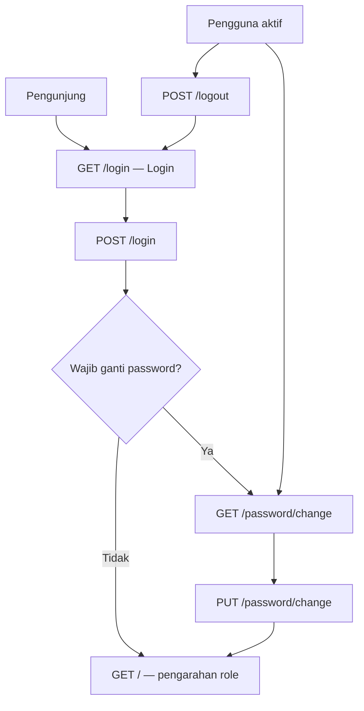
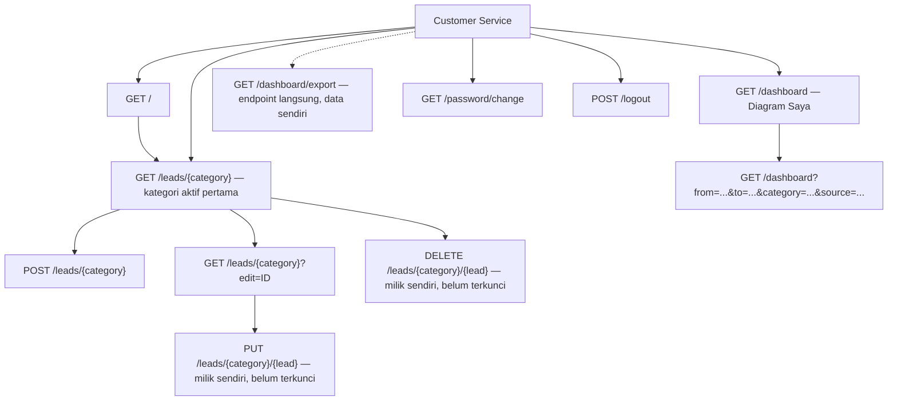
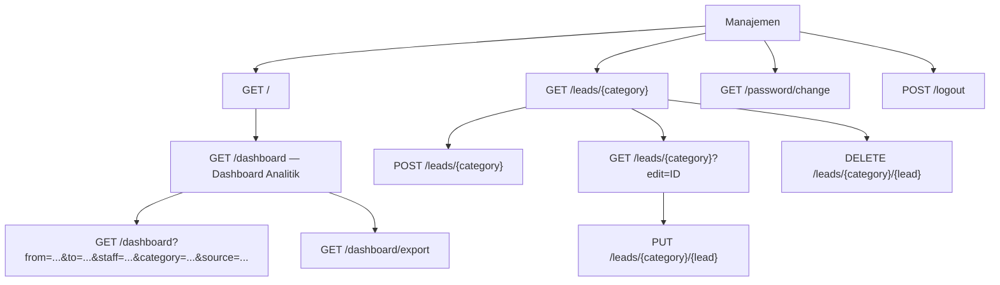
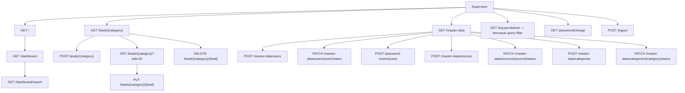

# 05 — Sitemap dan Route

Sumber utama: `routes/web.php`; pemeriksaan console `php artisan route:list --except-vendor -vv --no-interaction` menghasilkan 21 route aplikasi. URI parameter memakai ID hasil route binding, bukan nama kategori. Query `?edit=ID` menggunakan route daftar yang sama, bukan halaman route baru.

## Sitemap pengunjung dan fungsi bersama

## Sitemap Customer Service

## Sitemap Manajemen

## Sitemap Supervisor

Dashboard Supervisor menerima query filter yang sama dengan Manajemen. Seluruh node URI sitemap berasal dari `routes/web.php`; parameter query dijelaskan dalam controller/view terkait. Tidak ada node `welcome`, `/customers`, registrasi, atau self-service forgot-password karena tidak ada route aplikasi tersebut.

## Tabel route aplikasi

Singkatan middleware:

- **W** = grup default `web` (session, cookies, forgery protection, binding, dan middleware framework terkait).
- **G** = `guest`.
- **A** = `auth`, `account.active`.
- **P** = `password.changed`.
- **T** = `throttle:10,1`.

Kolom middleware mencantumkan grup/alias route, bukan ekspansi seluruh class default framework. Hasil console lingkungan pemeriksaan juga memperlihatkan `Laravel\Boost\Middleware\InjectBoost`; middleware pengembangan ini bukan mekanisme permission bisnis. Pemeriksaan role yang ditulis di controller/policy disebut dalam deskripsi dan bukan middleware route.

| Method | URI | Route name | Controller@method | Middleware | Description |
|---|---|---|---|---|---|
| GET\|HEAD | `/login` | `login` | `AuthController@create` | W, G | Form login |
| POST | `/login` | `login.store` | `AuthController@store` | W, G, T | Validasi kredensial, status, role; memulai session |
| GET\|HEAD | `/password/change` | `password.edit` | `PasswordController@edit` | W, A | Form ubah/wajib ganti password |
| PUT | `/password/change` | `password.update` | `PasswordController@update` | W, A | Memvalidasi dan mengganti password |
| POST | `/logout` | `logout` | `AuthController@destroy` | W, A | Mengakhiri session |
| GET\|HEAD | `/` | `home` | `HomeController@__invoke` | W, A, P | Redirect sesuai role/kategori aktif |
| GET\|HEAD | `/dashboard` | `dashboard` | `DashboardController@index` | W, A, P | Diagram pribadi atau analitik; query filter |
| GET\|HEAD | `/dashboard/export` | `dashboard.export` | `DashboardController@export` | W, A, P | Unduhan XLSX; query dibatasi sesuai role |
| GET\|HEAD | `/master-data` | `master-data.index` | `MasterDataController@index` | W, A, P | Daftar master; Supervisor server-side |
| GET\|HEAD | `/log-perubahan` | `audit-logs.index` | `AuditLogController@index` | W, A, P | Log/filter; Supervisor server-side |
| POST | `/master-data/users` | `master-data.users.store` | `MasterDataController@storeUser` | W, A, P | Membuat akun; Supervisor |
| PATCH | `/master-data/users/{user}/status` | `master-data.users.status` | `MasterDataController@toggleUser` | W, A, P | Toggle akun lain; Supervisor |
| POST | `/master-data/sources` | `master-data.sources.store` | `MasterDataController@storeSource` | W, A, P | Membuat sumber; Supervisor |
| PATCH | `/master-data/sources/{source}/status` | `master-data.sources.status` | `MasterDataController@toggleSource` | W, A, P | Toggle sumber; Supervisor |
| POST | `/master-data/categories` | `master-data.categories.store` | `MasterDataController@storeCategory` | W, A, P | Membuat kategori; Supervisor |
| PATCH | `/master-data/categories/{category}/status` | `master-data.categories.status` | `MasterDataController@toggleCategory` | W, A, P | Toggle kategori; Supervisor |
| POST | `/password-resets/{user}` | `password.resets.store` | `PasswordController@reset` | W, A, P, T | Reset akun lain; Supervisor |
| GET\|HEAD | `/leads/{category}` | `leads.index` | `LeadController@index` | W, A, P | Daftar/form; query `edit` memuat form edit |
| POST | `/leads/{category}` | `leads.store` | `LeadController@store` | W, A, P | Membuat rekap; policy create |
| PUT | `/leads/{category}/{lead}` | `leads.update` | `LeadController@update` | W, A, P | Memperbarui rekap; policy update |
| DELETE | `/leads/{category}/{lead}` | `leads.destroy` | `LeadController@destroy` | W, A, P | Soft delete; policy delete |

Empat route `leads.*` berada dalam grup `scopeBindings()`. Seluruh controller ada di namespace `App\Http\Controllers`.

## Route teknis di luar sitemap bisnis

`bootstrap/app.php` mendaftarkan health endpoint **GET `/up`**, yang tidak ditulis langsung di `routes/web.php` dan tidak dihitung pada 21 route aplikasi di atas. Tidak ada route API bisnis yang ditemukan. `routes/console.php` bukan halaman web. Route internal package/framework, asset server, dan storage tidak disajikan sebagai fitur CRM.
