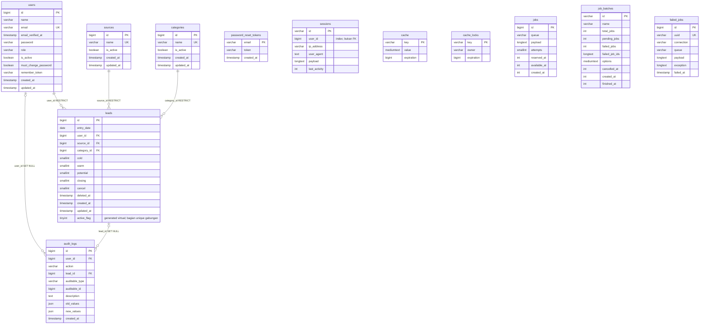

# 06 — ERD dan Kamus Data

## Cakupan dan konvensi

Skema direkonstruksi dari sembilan file dalam `database/migrations`, setelah seluruh `up()` diterapkan. Ini bukan dump database aktif. Terdapat **12 tabel** yang dibuat migration proyek; dua migration menambahkan kolom pada `users` dan `audit_logs`. Tabel repository `migrations` dibuat framework, bukan migration proyek, sehingga tidak masuk ERD ini.

Tipe mengikuti MySQL: `string` → `varchar`, `boolean` → `tinyint(1)`, `id/foreignId` → `bigint unsigned`. `AI` berarti auto increment. Default `—` berarti tidak ada default eksplisit pada migration; kolom nullable dapat bernilai NULL. `timestamps()` menghasilkan dua timestamp nullable. `PK`, `FK`, dan `UK` masing-masing berarti primary, foreign, dan unique key. UK gabungan dijelaskan pada catatan tabel; bukan berarti setiap anggotanya unik sendiri.

### Referensi migration

| Ref | File dalam `database/migrations/` |
|---|---|
| M1 | `0001_01_01_000000_create_users_table.php` |
| M2 | `0001_01_01_000001_create_cache_table.php` |
| M3 | `0001_01_01_000002_create_jobs_table.php` |
| M4 | `2026_10_23_100000_add_role_and_status_to_users_table.php` |
| M5 | `2026_10_23_100100_create_sources_table.php` |
| M6 | `2026_10_23_100200_create_categories_table.php` |
| M7 | `2026_10_23_100300_create_leads_table.php` |
| M8 | `2026_10_23_100400_create_audit_logs_table.php` |
| M9 | `2026_10_24_000000_add_auditable_subject_to_audit_logs_table.php` |

## ERD fisik

Hanya garis dengan FK yang didefinisikan migration ditampilkan. `sessions.user_id`, `password_reset_tokens.email`, dan pasangan polymorphic audit **tidak memiliki FK**, sehingga tidak digambarkan sebagai relasi fisik. Relasi model ada pada [10-class-diagram.md](10-class-diagram.md).

Setiap lead memiliki tepat satu user, source, dan category; setiap parent dapat memiliki nol atau banyak lead. Setiap audit dapat memiliki nol/satu pelaku dan nol/satu lead karena FK nullable. Tidak ada `CASCADE DELETE` atau `ON UPDATE` eksplisit dalam migration proyek.

## Kamus data

### `users` — M1 dan M4; model `User`

| Column | Type | Nullable | Default | Key/Index | Description |
|---|---|---|---|---|---|
| `id` | bigint unsigned | Tidak | AI | PK | Identitas akun |
| `name` | varchar(255) | Tidak | — | — | Nama pengguna |
| `email` | varchar(255) | Tidak | — | UK | Email login |
| `email_verified_at` | timestamp | Ya | — | — | Waktu verifikasi; tidak membuktikan adanya fitur verifikasi email |
| `password` | varchar(255) | Tidak | — | — | Hash password |
| `role` | varchar(30) | Tidak | `customer_service` | Index | Nilai enum PHP `Role`; bukan SQL ENUM |
| `is_active` | tinyint(1) | Tidak | true | — | Status akun |
| `must_change_password` | tinyint(1) | Tidak | false | — | Kewajiban pergantian password |
| `remember_token` | varchar(100) | Ya | — | — | Kolom autentikasi bawaan; tidak ada pilihan remember-me pada form |
| `created_at` | timestamp | Ya | — | — | Waktu pembuatan |
| `updated_at` | timestamp | Ya | — | — | Waktu perubahan |

Indeks eksplisit: PK `id`, `users_email_unique(email)`, `users_role_index(role)`. Tidak ada FK keluar atau soft delete.

### `sources` — M5; model `Source`

| Column | Type | Nullable | Default | Key/Index | Description |
|---|---|---|---|---|---|
| `id` | bigint unsigned | Tidak | AI | PK | Identitas sumber |
| `name` | varchar(100) | Tidak | — | UK | Nama sumber lead |
| `is_active` | tinyint(1) | Tidak | true | — | Ketersediaan input baru |
| `created_at` | timestamp | Ya | — | — | Waktu pembuatan |
| `updated_at` | timestamp | Ya | — | — | Waktu perubahan |

Indeks: PK dan `sources_name_unique(name)`. Tidak ada indeks eksplisit `is_active` atau soft delete.

### `categories` — M6; model `Category`

| Column | Type | Nullable | Default | Key/Index | Description |
|---|---|---|---|---|---|
| `id` | bigint unsigned | Tidak | AI | PK | Identitas kategori |
| `name` | varchar(100) | Tidak | — | UK | Nama kategori layanan |
| `is_active` | tinyint(1) | Tidak | true | — | Ketersediaan navigasi/input baru |
| `created_at` | timestamp | Ya | — | — | Waktu pembuatan |
| `updated_at` | timestamp | Ya | — | — | Waktu perubahan |

Indeks: PK dan `categories_name_unique(name)`. Tidak ada soft delete.

### `leads` — M7; model `Lead`

| Column | Type | Nullable | Default | Key/Index | Description |
|---|---|---|---|---|---|
| `id` | bigint unsigned | Tidak | AI | PK | Identitas rekap |
| `entry_date` | date | Tidak | — | Unique gabungan; index gabungan | Tanggal bisnis rekap |
| `user_id` | bigint unsigned | Tidak | — | FK; unique gabungan | Pemilik rekap, diarahkan ke CS oleh aplikasi |
| `source_id` | bigint unsigned | Tidak | — | FK; unique gabungan | Sumber lead |
| `category_id` | bigint unsigned | Tidak | — | FK; unique/index gabungan | Kategori layanan |
| `cold` | smallint unsigned | Tidak | 0 | — | Jumlah Cold |
| `warm` | smallint unsigned | Tidak | 0 | — | Jumlah Warm |
| `potential` | smallint unsigned | Tidak | 0 | — | Jumlah Potensial |
| `closing` | smallint unsigned | Tidak | 0 | — | Jumlah Closing |
| `cancel` | smallint unsigned | Tidak | 0 | — | Jumlah Cancel |
| `deleted_at` | timestamp | Ya | — | — | Penanda soft delete |
| `created_at` | timestamp | Ya | — | — | Waktu pembuatan |
| `updated_at` | timestamp | Ya | — | — | Waktu perubahan |
| `active_flag` | tinyint; generated virtual | Ya | Ekspresi | Unique gabungan | `CASE WHEN deleted_at IS NULL THEN 1 ELSE NULL END` |

Constraint dan indeks eksplisit:

- `leads_unique_active_entry`: UNIQUE (`entry_date`, `user_id`, `source_id`, `category_id`, `active_flag`). Satu kombinasi hanya memiliki satu baris aktif. `NULL` pada baris soft-deleted memungkinkan riwayat duplikat dan input ulang.
- `leads_category_id_entry_date_index`: (`category_id`, `entry_date`).
- `user_id → users.id`, `source_id → sources.id`, dan `category_id → categories.id`: **ON DELETE RESTRICT**. Soft-deleted lead tetap merupakan referensi database dan tetap menghalangi penghapusan parent.
- MySQL menyediakan indeks pendukung FK bila diperlukan. Nama indeks implisit aktual tidak diverifikasi; jangan dianggap indeks tambahan eksplisit migration.

Rentang tipe database unsigned smallint ialah 0–65535; aplikasi lebih ketat, 0–9999. Batas 30 hari, kepemilikan CS, dan konfirmasi >10 adalah aturan aplikasi, bukan constraint database. Tidak ada kolom total, nama pelanggan, atau telepon.

### `audit_logs` — M8 dan M9; model `AuditLog`

| Column | Type | Nullable | Default | Key/Index | Description |
|---|---|---|---|---|---|
| `id` | bigint unsigned | Tidak | AI | PK | Identitas audit |
| `user_id` | bigint unsigned | Ya | — | FK | Pelaku, bukan otomatis pemilik lead |
| `action` | varchar(20) | Tidak | — | — | Aksi aplikasi; bukan SQL ENUM |
| `lead_id` | bigint unsigned | Ya | — | FK | Referensi khusus rekap |
| `auditable_type` | varchar(255) | Ya | — | Index gabungan | Class/morph type subject |
| `auditable_id` | bigint unsigned | Ya | — | Index gabungan; bukan FK | Identitas subject polymorphic |
| `description` | text | Tidak | — | — | Ringkasan objek dan perubahan |
| `old_values` | json | Ya | — | — | Snapshot sebelum yang diberikan pemanggil |
| `new_values` | json | Ya | — | — | Snapshot sesudah yang diberikan pemanggil |
| `created_at` | timestamp | Tidak | CURRENT_TIMESTAMP | Index | Waktu pencatatan |

Indeks eksplisit: PK, `audit_logs_created_at_index(created_at)`, `audit_logs_auditable_type_auditable_id_index(auditable_type, auditable_id)`. FK `user_id → users.id` dan `lead_id → leads.id` memakai **ON DELETE SET NULL**, dengan indeks pendukung FK oleh MySQL. Tidak ada `updated_at`.

Pasangan polymorphic tidak memiliki constraint ke tabel subject maupun jaminan konsistensi dengan `lead_id`. `record()` mengisi keduanya untuk lead; `recordChange()` mengisi pasangan polymorphic untuk master/akun. Snapshot lead hanya lima jumlah status. `lead()` memakai `withTrashed()`, tetapi `auditable()` tidak menambahkan perlakuan tersebut. Soft delete tidak memicu `SET NULL`; hard delete dapat memicunya.

### `password_reset_tokens` — M1; infrastruktur

| Column | Type | Nullable | Default | Key/Index | Description |
|---|---|---|---|---|---|
| `email` | varchar(255) | Tidak | — | PK | Identitas broker reset bawaan |
| `token` | varchar(255) | Tidak | — | — | Token broker |
| `created_at` | timestamp | Ya | — | — | Waktu pembuatan token |

Tidak ada FK ke `users.email`. Tabel ini tidak digunakan oleh alur reset sementara Supervisor pada controller; keberadaan tabel bukan bukti fitur forgot-password melalui email.

### `sessions` — M1; infrastruktur

| Column | Type | Nullable | Default | Key/Index | Description |
|---|---|---|---|---|---|
| `id` | varchar(255) | Tidak | — | PK | Identitas session |
| `user_id` | bigint unsigned | Ya | — | Index; bukan FK | Pengguna session |
| `ip_address` | varchar(45) | Ya | — | — | Alamat IP |
| `user_agent` | text | Ya | — | — | Informasi browser |
| `payload` | longtext | Tidak | — | — | Payload session |
| `last_activity` | int signed | Tidak | — | Index | Waktu aktivitas dalam bentuk integer |

Indeks: PK, `sessions_user_id_index`, `sessions_last_activity_index`. Tidak ada delete behavior FK karena `foreignId()->index()` tidak disertai `constrained()`.

### `cache` — M2; infrastruktur

| Column | Type | Nullable | Default | Key/Index | Description |
|---|---|---|---|---|---|
| `key` | varchar(255) | Tidak | — | PK | Key cache |
| `value` | mediumtext | Tidak | — | — | Nilai cache |
| `expiration` | bigint signed | Tidak | — | Index | Waktu kedaluwarsa |

Indeks: PK dan `cache_expiration_index`. Tidak ada FK.

### `cache_locks` — M2; infrastruktur

| Column | Type | Nullable | Default | Key/Index | Description |
|---|---|---|---|---|---|
| `key` | varchar(255) | Tidak | — | PK | Identitas lock |
| `owner` | varchar(255) | Tidak | — | — | Pemilik lock |
| `expiration` | bigint signed | Tidak | — | Index | Waktu kedaluwarsa |

Indeks: PK dan `cache_locks_expiration_index`. Tidak ada FK.

### `jobs` — M3; infrastruktur

| Column | Type | Nullable | Default | Key/Index | Description |
|---|---|---|---|---|---|
| `id` | bigint unsigned | Tidak | AI | PK | Identitas job |
| `queue` | varchar(255) | Tidak | — | Index | Nama queue |
| `payload` | longtext | Tidak | — | — | Payload job |
| `attempts` | smallint unsigned | Tidak | — | — | Jumlah percobaan |
| `reserved_at` | int unsigned | Ya | — | — | Waktu reservasi |
| `available_at` | int unsigned | Tidak | — | — | Waktu siap diproses |
| `created_at` | int unsigned | Tidak | — | — | Waktu pembuatan integer |

Indeks: PK dan `jobs_queue_index`. Tidak ada FK. Keberadaan tabel tidak membuktikan adanya job bisnis aplikasi.

### `job_batches` — M3; infrastruktur

| Column | Type | Nullable | Default | Key/Index | Description |
|---|---|---|---|---|---|
| `id` | varchar(255) | Tidak | — | PK | Identitas batch |
| `name` | varchar(255) | Tidak | — | — | Nama batch |
| `total_jobs` | int signed | Tidak | — | — | Jumlah job total |
| `pending_jobs` | int signed | Tidak | — | — | Job belum selesai |
| `failed_jobs` | int signed | Tidak | — | — | Jumlah job gagal |
| `failed_job_ids` | longtext | Tidak | — | — | Daftar ID; bukan FK/tipe JSON |
| `options` | mediumtext | Ya | — | — | Opsi batch |
| `cancelled_at` | int signed | Ya | — | — | Waktu pembatalan |
| `created_at` | int signed | Tidak | — | — | Waktu pembuatan |
| `finished_at` | int signed | Ya | — | — | Waktu selesai |

Hanya PK; tidak ada FK.

### `failed_jobs` — M3; infrastruktur

| Column | Type | Nullable | Default | Key/Index | Description |
|---|---|---|---|---|---|
| `id` | bigint unsigned | Tidak | AI | PK | Identitas kegagalan |
| `uuid` | varchar(255) | Tidak | — | UK | UUID kegagalan |
| `connection` | varchar(255) | Tidak | — | Index gabungan | Nama connection |
| `queue` | varchar(255) | Tidak | — | Index gabungan | Nama queue |
| `payload` | longtext | Tidak | — | — | Payload |
| `exception` | longtext | Tidak | — | — | Rincian exception |
| `failed_at` | timestamp | Tidak | CURRENT_TIMESTAMP | Index gabungan | Waktu kegagalan |

Indeks: PK, `failed_jobs_uuid_unique(uuid)`, dan `failed_jobs_connection_queue_failed_at_index(connection, queue, failed_at)`. Tidak ada FK.

## Integritas dan batas data

Lima FK fisik seluruhnya tercakup ERD. Status aktif master tidak menghapus riwayat. Constraint database tidak memverifikasi role CS pada `leads.user_id`; pemeriksaan tersebut berada di controller. Nilai `action` dan `role` tidak dibatasi SQL ENUM/CHECK oleh migration. Relasi logical polymorphic sengaja dipisahkan dari relasi fisik agar diagram tidak mengada-adakan FK.

TODO: confirm with team — verifikasi versi MySQL, hasil penerapan migration, dan kesesuaian skema database operasional; dokumen ini menyatakan definisi kode, bukan kondisi database aktif.
