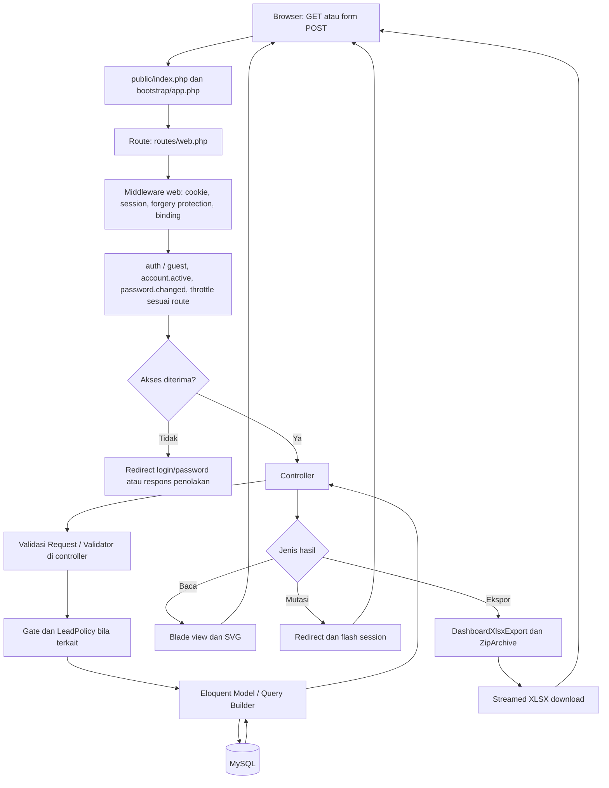
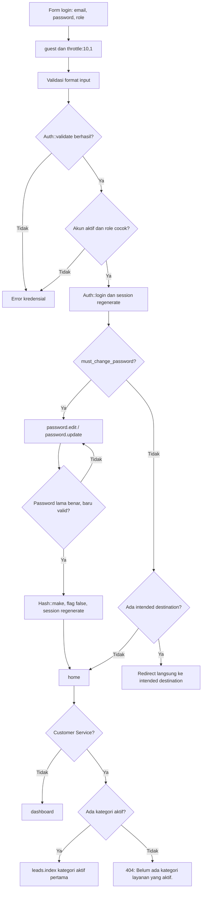

# 07 — Arsitektur Sistem

## Struktur aplikasi

UMI CRM memakai aplikasi Laravel monolitik berbasis server-rendered Blade dan Eloquent. Browser mengirim form/GET biasa, bukan request SPA/API bisnis. Database operasional dinyatakan MySQL pada metadata aplikasi; driver default pada file konfigurasi tidak membuktikan environment efektif. Analitik dibentuk dengan agregasi SQL dan diagram SVG yang dirender server. Tidak ditemukan service domain terpisah, repository custom, `FormRequest`, maupun job bisnis pada `app/`.

| Lapisan | Implementasi aktual |
|---|---|
| Entry point dan routing | `public/index.php`, `bootstrap/app.php`, `routes/web.php` |
| Middleware | `guest`, `auth`, `account.active`, `password.changed`, throttle serta grup `web` |
| Controller | `AuthController`, `HomeController`, `PasswordController`, `LeadController`, `DashboardController`, `MasterDataController`, `AuditLogController` |
| Validasi | `Request::validate` dan `Validator::make` dalam controller, bukan class FormRequest |
| Otorisasi | `LeadPolicy`, `Gate::authorize`, `isSupervisor()` pada controller |
| Model | `User`, `Lead`, `Source`, `Category`, `AuditLog`; trait `HasUmiAccount`; enum `Role` |
| Persistensi | MySQL, migration, FK, unique index, transaksi database; `SoftDeletes` untuk lead |
| View | `resources/views`, layout bersama, form Blade, script inline, SVG |
| Ekspor | `app/Exports/DashboardXlsxExport.php`, temporary files, `ZipArchive`, streamed download |

`AppServiceProvider` tidak menambahkan binding atau boot logic bisnis. Model/trait menyimpan relasi dan aturan akun/lead; controller masih menangani validasi, query, dan transaksi. Diagram tidak menyisipkan lapisan yang tidak ada.

## Request lifecycle aktual

Urutan validasi dan Gate bergantung method: misalnya `LeadController@store/update` memanggil Gate **sebelum** `save()` memvalidasi input. Diagram menyatakan komponen umum, bukan kontrak urutan sama untuk semua endpoint. Tidak ada participant FormRequest/Service fiktif: peran validasi diisi controller, sedangkan ekspor memakai class khusus.

### Mutasi dan audit

Create/update/delete lead, pembuatan/status akun/master, dan reset password memakai transaksi bersama audit. Jika operasi di dalam transaksi gagal, perubahan tersebut di-rollback. Soft delete mengisi `deleted_at`, bukan menghapus fisik. Pemeriksaan duplikat awal dilengkapi unique index database dan penanganan benturan constraint. Transaksi tidak otomatis menghilangkan semua race condition pada guard jumlah opsi aktif atau lost update; tidak ditemukan row lock/version column untuk itu.

## Alur autentikasi dan password

`AuthController@store` memvalidasi password sebelum memberi pesan khusus status/role. Password baru/reset di-hash secara eksplisit; `User` tidak mendeklarasikan cast `hashed`. Reset Supervisor menghasilkan password sementara dan flag wajib ganti; tidak menggunakan broker email meskipun tabel token bawaan ada. Logout menginvalidasi session saat ini. Tidak ada implementasi MFA atau pembatalan eksplisit seluruh session lintas perangkat.

## Technology stack

| Komponen | Teknologi / versi teramati | Penggunaan |
|---|---|---|
| Runtime backend | PHP 8.3; constraint `^8.3` | Eksekusi Laravel |
| Framework | Laravel 13.38.0 | Routing, middleware, session, validasi, Eloquent, Blade |
| Database | MySQL; versi belum diperiksa | Rekap, akun, master, audit dan tabel infrastruktur |
| Frontend operasional | Blade, HTML, CSS `public/css/umi.css`, JavaScript inline, SVG | Halaman CRM, sidebar mobile, konfirmasi, autosubmit |
| Asset tooling | Vite 8.3.5, plugin Laravel 3.2.0, Tailwind 4.3.3 | Entry `resources/css/app.css`, `resources/js/app.js`; bukan stylesheet utama CRM |
| Font | Plus Jakarta Sans melalui Google Fonts pada CSS operasional | Typography; permintaan font ke layanan eksternal |
| XLSX | `ZipArchive`, XML, temporary filesystem | Ekspor tanpa package Excel tambahan |
| Pengujian | PHPUnit 12.5.40, Mockery 1.6.15 | Feature/Unit; konfigurasi test SQLite memory |
| Dependency tooling | Composer dan npm; lock files tersedia | Instalasi dependency terkunci |

Vite juga memiliki konfigurasi Instrument Sans/Bunny untuk jalur asset/starter. `welcome.blade.php` bukan landing route CRM. Jangan menyebut aplikasi sebagai React/Vue/Livewire hanya karena package transitif atau contoh bawaan tersedia.

## Runtime requirements

- PHP yang kompatibel dengan constraint proyek dan dependency terkunci; periksa `composer check-platform-reqs` setelah instalasi.
- Extension PHP yang diperlukan Laravel/dependency; khusus aplikasi: koneksi PDO MySQL, `mbstring` untuk normalisasi email, dan `zip`/`ZipArchive` untuk ekspor. XML digunakan dalam pengujian ekspor. Daftar platform definitif ditentukan `composer.lock` dan hasil pemeriksaan platform.
- MySQL yang mendukung JSON dan generated virtual column berindeks; migration memakai fitur tersebut. Versi minimum operasional belum dibakukan dalam kode proyek.
- Web server dengan document root `public`, atau development server Artisan untuk lokal.
- Izin tulis pada `storage`, `bootstrap/cache`, dan direktori temporary sistem untuk ekspor; akses database sesuai konfigurasi.
- Composer; Node.js/npm kompatibel dengan `engines` Vite pada dependency terpasang jika menjalankan build.
- Akses internet untuk pemasangan dependency dan font eksternal; tidak ditemukan API eksternal bisnis yang wajib dipanggil untuk input/dashboard.

Deployment topology, kapasitas server, domain, TLS, scheduler/worker produksi, serta backup bukan hasil yang dapat dipastikan dari kode. Targetnya dirangkum pada NFR-09, NFR-17–19, NFR-25–26 dan TODO dalam [02](02-non-functional-requirements.md).
