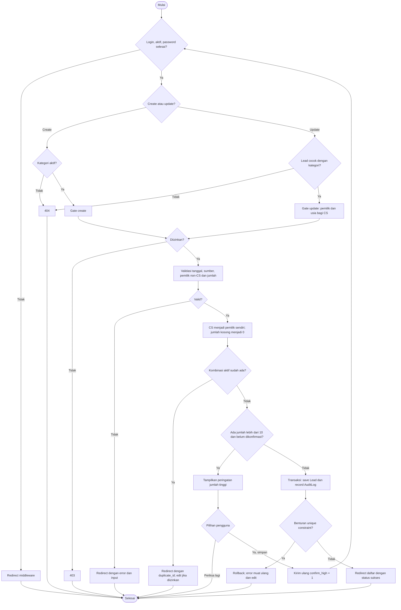
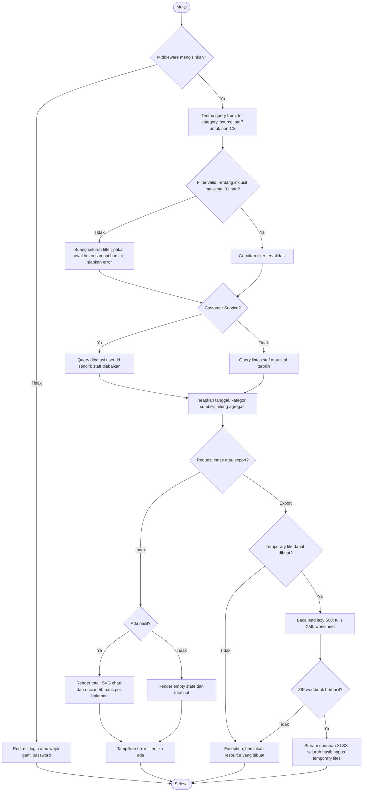
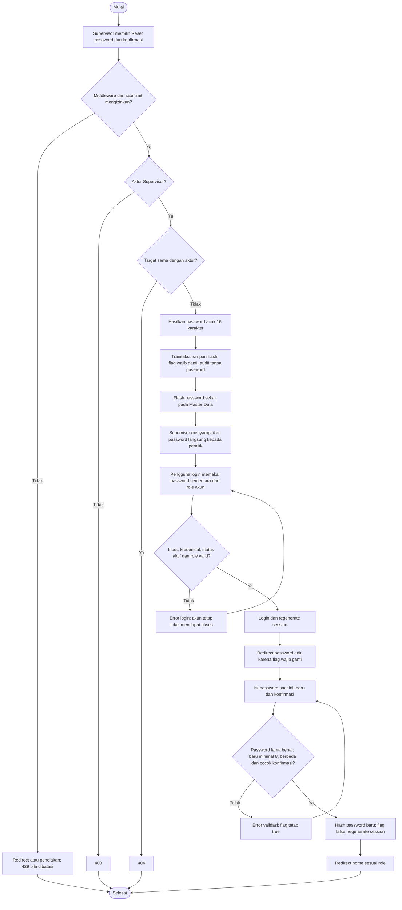

# 08 — Activity Diagram

## Pemilihan alur

| Alur | Alasan kepentingan dan kompleksitas | Traceability |
|---|---|---|
| A-01 — Menyimpan rekap lead (create/update) | Inti pencatatan CRM; melibatkan izin, batas tanggal, sumber/pemilik, duplikat, konfirmasi angka, transaksi dan audit | UC-05–06; FR-07–08, FR-10–11, FR-26 |
| A-02 — Analitik dan ekspor XLSX | Menyediakan informasi pengambilan keputusan; filter tervalidasi, pembatasan role, agregasi, pagination dan ekspor seluruh hasil | UC-08–11; FR-12–15 |
| A-03 — Reset Supervisor dan pergantian password wajib | Mengendalikan pemulihan akses dan keamanan; izin Supervisor, password sementara sekali tampil, audit, login serta middleware wajib ganti | UC-15, UC-01, UC-03; FR-01, FR-04–05, FR-19, FR-26 |

Urutan mengikuti controller, bukan rancangan fitur baru. Diagram sequence pada [09](09-sequence-diagrams.md) menggunakan tiga alur yang sama.

## A-01 — Penyimpanan rekap lead

Sumber: `LeadController@index/store/update/save`, `LeadPolicy`, `Lead::isEditableBy`, migration lead. Diagram berfokus pada create/update; soft delete dijelaskan di UC-07 dan class/ERD.

Create semua role dibatasi tanggal ≥hari ini minus 30 hari dan ≤hari ini. Update CS memakai batas sama; update non-CS tidak memiliki batas usia minimum. Update tidak menambahkan pengecekan kategori aktif seperti create. Exception selain benturan unique tidak memiliki pesan pemulihan custom di method ini; transaksi tetap mengikuti rollback framework.

## A-02 — Analitik dan ekspor

Sumber: `DashboardController@index/export/dashboardData`, `DashboardXlsxExport`, `dashboard.blade.php`.

Ekspor invalid-filter memakai default yang sama tetapi tidak merender pesan error halaman. CS dapat meminta endpoint langsung walaupun tombol tidak terlihat. Tidak ada query pembaruan database pada alur ini.

## A-03 — Reset dan pergantian password wajib

Sumber: `PasswordController@reset/update`, `AuthController@store`, `EnsurePasswordIsChanged`, `master-data.blade.php`, `password-change.blade.php`.

Reset tidak mengaktifkan akun nonaktif. Penyampaian password adalah langkah manusia yang diarahkan teks UI, bukan pengiriman email otomatis. Tidak ada bukti mekanisme aplikasi yang mencabut semua session perangkat lain.
