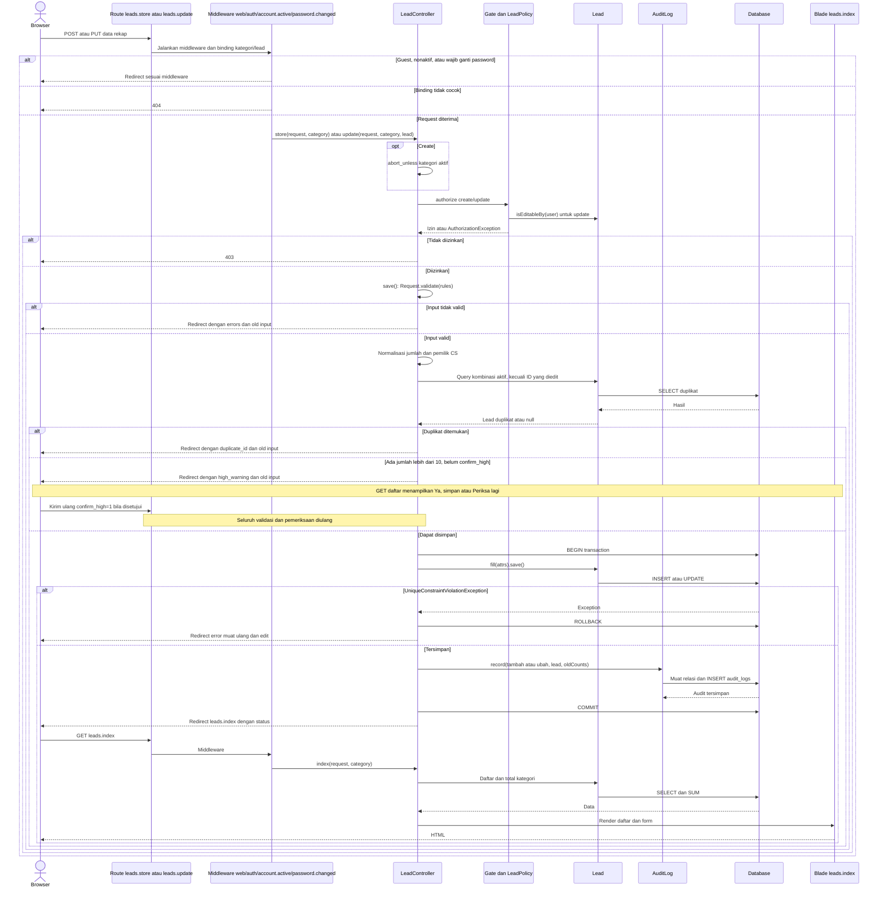

# 09 — Sequence Diagram

Tiga alur berikut sama dengan A-01–A-03 pada [08-activity-diagrams.md](08-activity-diagrams.md). Participant menggunakan class/lapisan yang benar-benar ada. **Tidak ada class FormRequest dalam proyek:** validasi dilakukan oleh `Request::validate` atau `Validator::make` di controller; keduanya ditulis sebagai self-call. Database berarti koneksi MySQL operasional yang dinyatakan pada metadata. Route dan middleware merupakan lapisan dispatch, bukan class bisnis tambahan.

## SQ-01 — Menyimpan rekap lead

UC-05–06; FR-07–08, FR-10–11, FR-26. Gate dipanggil sebelum `save()` melakukan validasi.



Pemanggilan GET setelah redirect melewati route `leads.index`, meskipun participant Route dikelompokkan agar diagram tetap terbaca. Audit failure juga menyebabkan rollback; diagram menonjolkan exception unique karena ditangani secara khusus oleh controller. Create kategori nonaktif berhenti dengan 404 sebelum Gate.

## SQ-02 — Dashboard dan ekspor XLSX

UC-08–11; FR-12–15. Pembentukan query dan agregasi `dashboardData()` dipakai baik index maupun export.

```mermaid
sequenceDiagram
    actor B as Browser
    participant R as Route dashboard atau dashboard.export
    participant W as Middleware web/auth/account.active/password.changed
    participant C as DashboardController
    participant M as Lead, User, Category, Source
    participant D as Database
    participant V as Blade dashboard
    participant E as DashboardXlsxExport
    participant F as Temporary filesystem dan ZipArchive
    B->>R: GET dengan query filter
    R->>W: Pemeriksaan akses
    alt Tidak memenuhi middleware
        W-->>B: Redirect login atau password.edit
    else Akses diterima
        W->>C: index(request) atau export(request, export)
        C->>C: dashboardData(): Validator.make dan after callback
        alt Filter invalid
            C->>C: filters=[]; default awal bulan sampai hari ini; simpan error
        else Filter valid
            C->>C: Gunakan tanggal, kategori, sumber, staf yang tervalidasi
        end
        C->>M: Bangun query lead sesuai role
        Note over C,M: CS selalu user_id sendiri; staff tidak dapat menggantinya
        M->>D: Agregasi COUNT/SUM dan kelompok sumber/staf/kategori
        D-->>M: Total dan kelompok
        M-->>C: Data dashboard
        alt Route dashboard
            C->>M: Eager load rincian; simplePaginate(50)
            M->>D: SELECT rincian dan relasi
            D-->>C: Hasil halaman
            C->>V: Render total, SVG, rincian, filter errors
            V-->>B: HTML atau empty state
        else Route dashboard.export
            C->>E: create(query)
            E->>F: Buat file sementara workbook dan worksheet
            loop lazy(500) sampai seluruh hasil selesai
                E->>M: Baca lead dan relasi bertahap
                M->>D: SELECT batch
                D-->>E: Baris hasil
                E->>F: Tulis XML, inline strings dan angka
            end
            E->>F: Susun ZIP workbook Laporan Leads
            alt Gagal file atau ZIP
                F-->>E: Kegagalan
                E->>F: Bersihkan temporary files yang tersedia
                E-->>C: Exception
                C-->>B: Respons error framework
            else Berhasil
                E-->>C: Path workbook
                C-->>B: Stream download umi-crm-from-sd-to.xlsx
                C->>F: Tutup stream dan hapus workbook
            end
        end
    end
```

Cabang error menyederhanakan beberapa titik gagal; `create()` memiliki `catch/finally`, dan stream controller juga memiliki `finally`. Tidak ada jaminan unduhan berhasil pada kegagalan I/O. Ekspor dengan filter invalid menggunakan query default; tidak merender pesan validasi dashboard.

## SQ-03 — Reset dan pergantian password wajib

UC-15, UC-01, UC-03; FR-01, FR-04–05, FR-19, FR-26. Dua browser menunjukkan interaksi manusia Supervisor dan pemilik akun, bukan layanan pengiriman otomatis.

```mermaid
sequenceDiagram
    actor S as Browser Supervisor
    actor B as Browser pemilik akun
    participant R as Route password.resets.store/login.store/password.update
    participant W as Middleware sesuai route
    participant C as PasswordController
    participant AC as AuthController
    participant U as User
    participant A as AuditLog
    participant D as Database
    participant V as Blade master-data/password-change
    S->>R: POST password-resets/target setelah confirm
    R->>W: auth, account.active, password.changed, throttle:10,1
    W->>C: reset(request, user)
    C->>C: Periksa Supervisor dan target bukan diri sendiri
    alt Bukan Supervisor atau target sendiri
        C-->>S: 403 atau 404
    else Diizinkan
        C->>C: Str.password(16), Hash.make
        C->>D: BEGIN transaction
        C->>U: Simpan hash dan must_change_password=true
        U->>D: UPDATE users
        C->>A: recordChange(reset_password), tanpa password
        A->>D: INSERT audit_logs
        C->>D: COMMIT
        C-->>S: Redirect master-data.index dan flash password
        Note over S,V: GET Master Data merender password sementara sekali
        S->>B: Sampaikan password secara langsung di luar aplikasi
        B->>R: POST login dengan email, password sementara, role
        R->>W: guest, throttle:10,1 dan web
        W->>AC: store(request)
        AC->>AC: Validasi input dan Auth.validate
        AC->>U: Ambil akun dan periksa status/role
        U->>D: SELECT users
        D-->>AC: Data akun
        alt Kredensial, status atau role tidak valid
            AC-->>B: Redirect error login
        else Valid
            AC->>AC: Auth.login dan session.regenerate
            AC-->>B: Redirect password.edit
            B->>R: GET password/change
            R->>W: auth dan account.active
            W->>C: edit(request)
            C->>V: Render Ganti Password
            V-->>B: Form wajib ganti
            Note over B,W: Request operasional saat flag true dialihkan oleh password.changed
            B->>R: PUT password/change dengan password lama, baru, konfirmasi
            R->>W: auth dan account.active
            W->>C: update(request)
            C->>C: Request.validate current_password/min/confirmed/different
            alt Validasi gagal
                C-->>B: Redirect dengan error; flag tetap true
            else Validasi berhasil
                C->>U: Hash.make password baru; flag false; save
                U->>D: UPDATE users
                C->>C: session.regenerate
                C-->>B: Redirect home dengan status sukses
            end
        end
    end
```

Middleware dapat menghentikan reset sebelum controller (guest, nonaktif, wajib ganti, atau rate limit). Reset akun nonaktif tetap menyisakan status nonaktif. Tidak ada notifikasi email, broker token, maupun revokasi semua session yang ditambahkan ke diagram.
