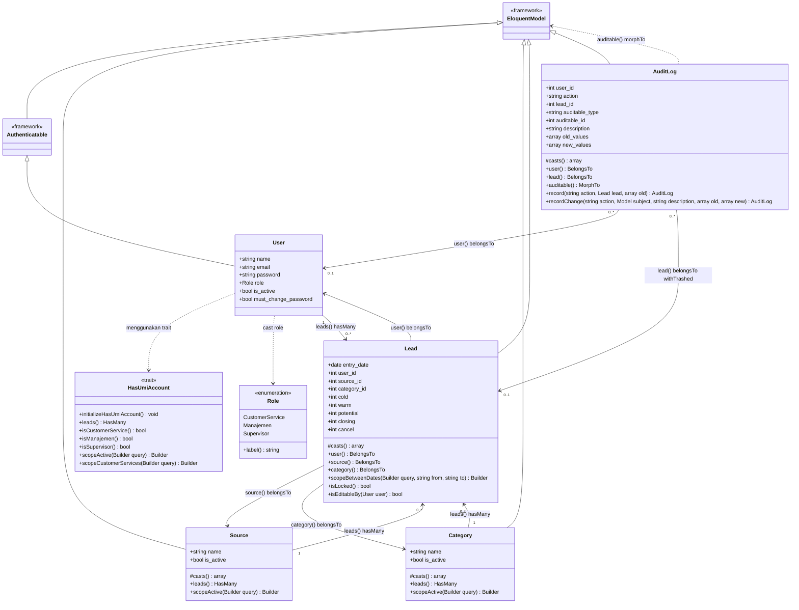

# 10 — Class Diagram Model Eloquent

Sumber: seluruh file `app/Models`, trait `app/Models/Concerns/HasUmiAccount.php`, dan `app/Enums/Role.php`. Atribut pada lima model di bawah merupakan **fillable efektif**, bukan seluruh kolom fisik. Atribut PK/timestamp/generated/hidden yang tidak fillable dijelaskan sesudah diagram. Method bawaan Eloquent tidak diperluas agar diagram berfokus pada implementasi proyek.

Garis `AuditLog → EloquentModel` mewakili relasi polymorphic, bukan FK ke tabel bernama model. Pemanggil aktual `recordChange` menggunakan `User`, `Source`, dan `Category`; `record` memakai `Lead`. Tidak ada relasi balik `auditLogs()`/`morphMany()` yang dideklarasikan pada model-model subject.

## Konfigurasi dan method penting

| Class | Konfigurasi / perilaku yang tidak seluruhnya tampak pada diagram |
|---|---|
| `User` | Mewarisi `Illuminate\Foundation\Auth\User`; menggunakan `HasFactory`, `Notifiable`, `HasUmiAccount`; atribut `#[Fillable]` awal `name,email,password`, ditambah `role,is_active,must_change_password` oleh initializer trait; hidden `password,remember_token` |
| `HasUmiAccount` | Menambahkan cast `role → Role`, `is_active → boolean`, `must_change_password → boolean`; scope aktif dan scope role CS terpisah, bukan global scope |
| `Source`, `Category` | Cast `is_active → boolean`; `scopeActive` hanya berlaku bila dipanggil; tidak memakai soft delete |
| `Lead` | Memakai `SoftDeletes`; `LOCK_DAYS = 30`; `STATUSES` memetakan `cold/Cold`, `warm/Warm`, `potential/Potensial`, `closing/Closing`, `cancel/Cancel`; cast tanggal `date:Y-m-d`, lima jumlah integer |
| `AuditLog` | `UPDATED_AT = null`; cast `old_values,new_values → array`; `record` dan `recordChange` merupakan method static; argumen old/new nullable dengan default `null` |
| `Role` | String-backed enum: `CustomerService = customer_service`, `Manajemen = manajemen`, `Supervisor = supervisor`; `label()` menyediakan label UI |

### Aturan lead

- `scopeBetweenDates($query, $from, $to)` menerapkan `whereBetween(entry_date, ...)`, inklusif. Adanya scope tidak berarti seluruh controller menggunakannya; dashboard membuat batas tanggal langsung pada query.
- `isLocked()` membandingkan tanggal lebih awal dari `today()->subDays(30)`; tepat 30 hari belum terkunci.
- `isEditableBy(User)` menolak akun nonaktif, membatasi CS pada kepemilikan dan umur, serta mengizinkan pengguna aktif non-CS.
- Aturan model ini dijalankan melalui `LeadPolicy` untuk update/delete; bukan global guard setiap query database.
- `active_flag` merupakan generated column database, tidak fillable dan tidak dihitung oleh method model.

### Aturan audit

- `record($action, $lead, $old = null)` memuat user/source/category, mengambil pelaku dari `Auth::id()`, mengisi `lead_id` dan pasangan polymorphic, menyusun deskripsi, dan menyimpan lima jumlah status. Nilai lama dibatasi pada key status.
- `recordChange($action, Model $subject, $description, $old = null, $new = null)` menyimpan subject polymorphic dan snapshot yang diberikan pemanggil; tidak otomatis mengisi `lead_id`.
- `lead()` menggunakan `withTrashed()` untuk mempertahankan akses relasi setelah soft delete; `auditable()` tidak mendeklarasikan pengecualian tersebut.
- Nilai snapshot nullable dan ID nullable pada audit mengikuti skema; tipe sederhana diagram tidak menyatakan constraint non-null untuk semuanya.

## Batas model

Tidak ada model aplikasi untuk tabel session/cache/queue/token. Tidak ada accessor total lead, model customer individual, model transaksi, atau method pengiriman WhatsApp/email bisnis. `User` tidak mendeklarasikan cast password `hashed`; hashing dilakukan eksplisit di controller/seeder. Kolom fisik lengkap dan aturan FK tersedia di [06](06-erd-and-data-dictionary.md), sedangkan pemanggilan model dalam alur ada di [09](09-sequence-diagrams.md).
